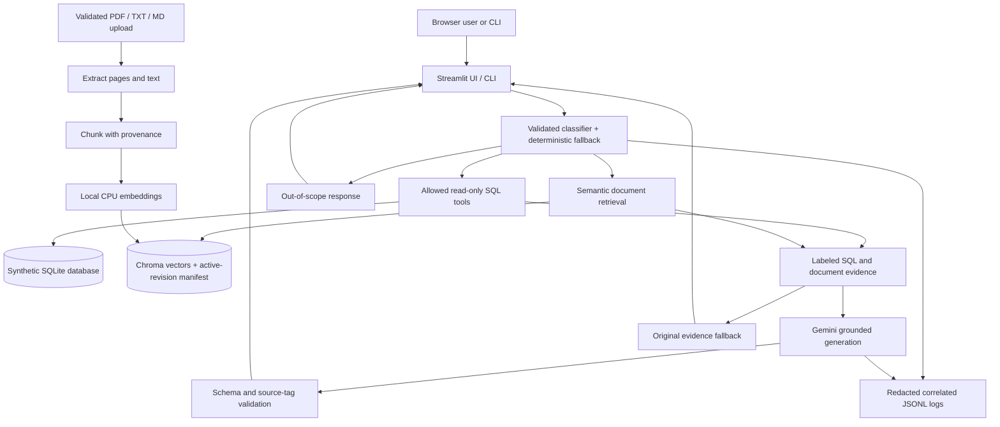

# UniHybrid AI — Final Project Report

**Release:** 1.0.0  
**Report date:** 24 November 2026, Asia/Calcutta  
**Project:** Local university assistant combining structured records and document retrieval  
**Implementation status:** Original Phases 00–08 completed; Phase 08 includes the user's recorded acceptance of 20 review answers.

## Contents

1. [Project purpose and scope](#1-project-purpose-and-scope)
2. [Technologies and reasons for using them](#2-technologies-and-reasons-for-using-them)
3. [Architecture and request flow](#3-architecture-and-request-flow)
4. [Implemented features](#4-implemented-features)
5. [Data model and synthetic fixtures](#5-data-model-and-synthetic-fixtures)
6. [Document ingestion and retrieval](#6-document-ingestion-and-retrieval)
7. [Routing, generation, and failure handling](#7-routing-generation-and-failure-handling)
8. [Safety, privacy, and operational controls](#8-safety-privacy-and-operational-controls)
9. [Configuration](#9-configuration)
10. [Implementation phases](#10-implementation-phases)
11. [Testing and passed scenarios](#11-testing-and-passed-scenarios)
12. [Measured evaluation](#12-measured-evaluation)
13. [Review provenance](#13-review-provenance)
14. [Docker release and portable archive](#14-docker-release-and-portable-archive)
15. [Installation and operation](#15-installation-and-operation)
16. [Project structure](#16-project-structure)
17. [Difficulties and resolutions](#17-difficulties-and-resolutions)
18. [Limitations and possible future work](#18-limitations-and-possible-future-work)
19. [Deliverables and evidence](#19-deliverables-and-evidence)
20. [Automated test inventory](#20-automated-test-inventory)
21. [Question-level evaluation results](#21-question-level-evaluation-results)

## 1. Project purpose and scope

UniHybrid AI answers university questions using two kinds of evidence: structured
student records and policy documents. A question can require records, documents,
both, or neither when it is outside the application's scope.

Examples include a student's GPA and fee status, examination attendance rules,
and scholarship eligibility based on both student facts and policy criteria.
The interface displays the answer alongside its SQL and document sources.
Missing information, conflicting notices, and unavailable external services are
reported explicitly.

This release is a **local demonstration using synthetic data**. Student selection
sets the context for queries; it is not authentication. No real student records,
production access-control system, or public hosting are included.

## 2. Technologies and reasons for using them

Versions below describe the project pins and recorded release environment, rather
than claims about the latest versions available elsewhere.

| Technology | Version / configuration | Role | Reason for using it |
| --- | --- | --- | --- |
| Python | 3.13.14 verified | Application, ingestion, querying, evaluation and scripts | One language supports the local data, document, ML and UI components and makes them independently testable. |
| Streamlit | 1.67.0 | Browser interface, chat, student selection, uploads and source panels | Supports the Python demo interface without a separate JavaScript application or frontend build pipeline. |
| SQLite | Python standard-library integration | Departments, students, fees, courses and enrollments | Embedded relational storage fits the small local dataset and supports fixed queries, constraints and read-only application connections without a database server. |
| ChromaDB | 1.5.9 | Persistent chunk vectors and cosine retrieval | Stores embeddings and provenance locally and supports filtering to active document revisions. |
| Sentence Transformers | 6.3.0 | Embedding API | Provides the local text-to-vector pipeline used for ingestion and query matching. |
| all-MiniLM-L6-v2 | `sentence-transformers/all-MiniLM-L6-v2`; revision pinned | 384-dimensional normalized embeddings | Supplies a CPU-based semantic representation for local document retrieval without sending every document to a remote embedding API. No comparative model benchmark is claimed. |
| PyTorch | 2.15.0; Docker reports `2.15.0+cpu` | Embedding model execution | Runs the local embedding model. The Docker build deliberately installs CPU wheels to avoid CUDA dependencies for this demo. |
| PyMuPDF | 2.1, as pinned and recorded | PDF text extraction with page provenance | Allows PDF policy text to be extracted while retaining page numbers for citations. Scanned-image OCR is outside scope. |
| Google Gen AI SDK | `google-genai` 3.6.1 | Gemini classification and answer generation | Centralizes model calls, structured responses, timeout/retry behavior and error handling in one wrapper. |
| Gemini | Configured and smoke-tested `gemini-3.5-flash-lite` | Route classification and evidence-grounded answer text | Generates the natural-language interpretation of retrieved evidence. Availability depends on the configured account, network and quota. |
| python-dotenv | 1.2.4 | Optional local `.env` loading | Keeps runtime credentials/configuration separate from source code and container layers. |
| Docker / Docker Desktop | Server 29.7.2 recorded | Linux runtime/test images and portable packaging | Provides a repeatable execution environment for the Python/ML dependency stack. |
| Docker Compose | Local installed Compose CLI | App, initialization and test services; named volumes | Coordinates startup and storage without adding database server containers. |
| pytest | 9.2.0 | Automated tests | Verifies configuration, data safety, retrieval, routing, answers, UI behavior, logging and evaluation calculations. |
| Streamlit AppTest | Included with Streamlit | Automated UI checks | Exercises session and presentation behavior within the Python test suite. |
| Chrome DevTools + websocket-client | Host Chrome; websocket-client 1.9.2 | Actual browser interaction checks | Verifies rendered chats, controls, source panels, student changes and uploads against the running Docker app. |
| JSON, JSONL and CSV | Python standard library | Evidence, logs, metadata and evaluation artifacts | Keeps request traces and measured results inspectable without an additional analytics service. |
| SHA-256 | Python `hashlib` | Dataset/source identity, stable identifiers and archive integrity | Connects evidence to recorded inputs and verifies the exported image archive. A checksum establishes integrity relative to the recorded value, not external publisher authenticity. |

The application uses plain Python modules. LangChain, a separate REST backend,
a JavaScript frontend, and standalone SQLite/vector database services were not
required for the implemented local architecture.

## 3. Architecture and request flow



1. The user selects a synthetic student when asking a personal question.
2. The router selects a permitted route and fixed SQL tools. Invalid/unavailable
   model classification falls back to deterministic rules.
3. The orchestrator retrieves the necessary SQL rows and/or document chunks.
4. Evidence receives stable request-local tags such as `[SQL-1]` and `[DOC-1]`.
5. In live mode, Gemini receives the question and supplied evidence. Its output
   must have the expected answer sections and valid source references.
6. The UI displays the result, source details, warnings and timing. Generation
   failures preserve original evidence rather than discard the successful reads.
7. Execution and model-call logs share a request ID.

## 4. Implemented features

| Area | Delivered behavior |
| --- | --- |
| Student context | Selector for 25 fictional students; changes clear conversation history. |
| Structured queries | Student profile, current-term fees, enrollments/grades and department statistics. |
| Document questions | Policy, handbook and notice retrieval with file/page/chunk provenance. |
| Hybrid questions | Student records combined with policy criteria, including scholarship eligibility. |
| Scope control | Unrelated questions receive an out-of-scope response without answer generation. |
| Grounded responses | Answer, brief evidence explanation and missing-information sections with citations. |
| Source inspection | SQL evidence and document source panels. |
| Uploads | PDF, TXT and MD; safe filenames, nonempty content, parse and size checks. |
| Index updates | Re-ingestion without duplicates, replacement handling and safe core deletion helpers. |
| Local evidence mode | Explicitly disables Gemini requests and displays retrieved evidence. |
| Failure handling | Readable missing-record, missing-document, model, API, upload and storage warnings. |
| Session chat | Conversation display and clear control; session history does not survive server restart. |
| Logging | Redacted execution/prompt JSONL, request correlation, rotation and retention. |
| Evaluation | 40 labeled questions; separate offline/live runs, ingestion controls and latency metrics. |
| Packaging | Phase images, final runtime/test images, verified runtime archive and initialization instructions. |

## 5. Data model and synthetic fixtures

### Relational schema

| Table | Main contents | Important relationship / constraint |
| --- | --- | --- |
| `departments` | Department ID and name | Unique department names. |
| `students` | ID, name, department, year, GPA, email | Department foreign key; year 1–4; GPA 0–10; unique email. |
| `fees` | Student, term, due/paid amounts, status, due date | Student/term primary key; valid payment bounds; status consistent with payment. |
| `courses` | Course ID, name, department, credits | Department foreign key; credits 1–6. |
| `enrollments` | Student/course link and grade | Student/course primary key; allowed grade values or null. |

Student identifiers use `S-001` through `S-025`. Seeding is safe to repeat and
preserves existing records. Query helpers open SQLite read-only.

### Demonstration records

| Student | Relevant fixture facts | Purpose |
| --- | --- | --- |
| `S-012` | GPA 8.4, year 3, current-term fees Paid with zero outstanding | Main structured and scholarship examples. |
| `S-002` | GPA 8.7, year 2, outstanding fees 30,000, Overdue | Demonstrates that overdue current-term fees prevent meeting scholarship criteria. |
| `S-001` | GPA 8.0, year 2, Paid | Tests the inclusive GPA boundary. |

### Bundled documents

| File | Contents used in the demonstration |
| --- | --- |
| `Academic_Regulations.pdf` | Academic rules, including 75% attendance in each course; attendance evidence is on page 4. |
| `Scholarship_Policy.pdf` | Merit criteria: GPA at least 8.0, year 2/3/4, no outstanding current-term fees. |
| `Student_Handbook.txt` | Student/library information, including borrowing rules. |
| `Notices_2026.txt` | Dated notices used to expose application-deadline conflicts. |

The corpus intentionally includes 15 December versus 20 December 2026 deadline
statements. The application must show the conflicting evidence and avoid claiming
policy authority from ingestion time or publication recency alone.

## 6. Document ingestion and retrieval

Uploads pass filename, extension, content, size and parse validation. Original
upload binaries are staged temporarily and removed after processing; extracted
indexed text persists. Supported formats are PDF/TXT/MD, up to 20 MB. OCR is not
implemented.

Chunks retain source file, page, stable public chunk ID and any parsed publication
or effective date. Defaults are **500 characters per chunk** and **80 characters
overlap**; these are character counts, not token counts. The chunker prefers usable
paragraph/sentence boundaries and preserves page boundaries.

The MiniLM revision is `1110a243fdf4706b3f48f1d95db1a4f5529b4d41`.
It produces normalized 384-dimensional vectors. Chroma uses
cosine search; the exposed score is `1 - cosine distance`. Default retrieval asks
for five matches and filters below similarity 0.35. The evaluation's **hit@3**
metric inspects the first three returned chunks; it does not change the application's
configured top-k to three.

Each replacement stages a new document revision before atomically publishing its
manifest entry. Retrieval filters by active revisions. Failed replacement or stale
cleanup does not make partial/inactive vectors visible. One application process
owns ingestion writes in this local demo.

Initialization is non-destructive after the completion marker is written. An
explicit `--refresh-fixtures` command restores/replaces bundled fixture names;
normal restart preserves user replacements and deletions.

## 7. Routing, generation, and failure handling

| Route | Required evidence | Example |
| --- | --- | --- |
| `STRUCTURED` | Allowed SQL results | What is my GPA and fee status? |
| `UNSTRUCTURED` | Retrieved document chunks | What is the minimum attendance? |
| `HYBRID` | SQL plus policy evidence | Am I eligible for a merit scholarship? |
| `OUT_OF_SCOPE` | No retrieval/answer-generation requirement | Who won the cricket match? |

The SQL registry contains `get_student_profile`, `get_fee_status`, `get_enrollments`
and `get_department_stats`. Department context is derived from the selected
student's profile. Student identity and SQL arguments are controlled by the
application, not model output. Personal scholarship routing requires profile and
current-term fees.

The answer generator accepts only the expected JSON fields: `answer`, `reasoning`
and `missing_information`. It checks nonempty sections, supplied source tags and
branch coverage. Grouped valid tags can be normalized to individual references.
These are structural checks; they cannot prove the semantic truth of every claim.

Missing credentials, blocked/invalid output, timeout and provider errors produce
readable fallbacks. Defaults allow up to two retries for retryable 429/5xx responses
and a 15-second per-attempt timeout. Classification and answer generation can each
make a call, so the total query duration can exceed one timeout interval.

## 8. Safety, privacy, and operational controls

- All included student records and policy files are synthetic.
- The model cannot author executable SQL or choose arbitrary tools/arguments.
- Database reads use fixed SQL, bound parameters and read-only connections.
- Student and department identifiers are validated, including injection cases.
- User questions and document text are treated as untrusted data in model prompts.
- Upload names reject traversal and unsupported/unsafe forms; content is parsed.
- Failed retrieval branches do not discard evidence from successful branches.
- Missing facts and conflicting dates must remain visible.
- Secrets are supplied at runtime; `.env` is excluded from Git and image context.
- Nested log fields and prompt/response text pass through secret redaction.
- Logs rotate at a configured size and logging failures warn without losing answers.
- Containers run as non-root user `app`; the normal app binds to host loopback.
- Tests use isolated storage rather than modifying the active demonstration database.

These controls do not provide production authentication, user authorization,
complete prompt-injection protection or a general privacy guarantee. Before real
student data is introduced, access control, retention and operational policy need
separate implementation and review.

## 9. Configuration

| Setting | Default | Meaning |
| --- | --- | --- |
| `GEMINI_API_KEY` | Empty | Optional runtime credential; never put the value in this report. |
| `MODEL_NAME` | `gemini-3.5-flash-lite` | Configurable Gemini model. |
| `CURRENT_TERM` | `2026-FALL` | Term used for fee reads. |
| `TOP_K` | 5 | Maximum requested retrieval matches. |
| `SIM_THRESHOLD` | 0.35 | Minimum retained cosine similarity. |
| `CHUNK_SIZE` / `CHUNK_OVERLAP` | 500 / 80 | Character chunk size and overlap. |
| `UPLOAD_LIMIT_MB` | 20 | Upload size ceiling. |
| `LLM_TIMEOUT_SECONDS` | 15 | Per-attempt timeout; validated range 10–15. |
| `LLM_MAX_RETRIES` | 2 | Maximum additional retry attempts. |
| `LLM_BACKOFF_SECONDS` | 1 | Retry backoff configuration. |
| `LOG_MAX_BYTES` | 5,000,000 | Configured per-file rotation size. |
| `LOG_BACKUPS` | 3 | Retained rotated backups. |

Paths can be configured through `DATA_DIR`, `DB_PATH`, `CHROMA_DIR`, `RAW_DOCS_DIR`,
`LOGS_DIR` and `MODEL_CACHE`. Configuration validation happens locally; imports
do not contact external services. `HF_HUB_OFFLINE=1` restricts embedding-model
cache access; it does not disable Gemini networking. Use local-evidence mode or
CLI `--offline` to disable Gemini requests.

## 10. Implementation phases

All counts below are cumulative at each checkpoint, not independent totals to add.

| Phase | Delivered area | Recorded host / container tests | Outcome |
| --- | --- | --- | --- |
| 00 | Configuration, environment, dependencies, Docker foundation | 15 / 15 | Passed |
| 01 | Synthetic database and safe queries | 25 / 25 | Passed |
| 02 | Extraction, chunks, embeddings and persistent retrieval | 47 / 47 | Passed |
| 03 | Gemini wrapper and dependency failures | 65 / 65 | Passed |
| 04 | Four-route classifier and CLI orchestration | 122 / 122 | Passed |
| 05 | Grounded answers and citation validation | 139 / 139 | Passed |
| 06 | Streamlit UI and browser behavior | 147 / 147 | Passed |
| 07 | Logging and non-destructive bootstrap | 157 / 157 | Passed |
| 08 | Evaluation, demo materials and final image/archive verification | 170 / 170 | Passed with recorded user review acceptance |

Individual reports are available under [docs/reports](docs/reports/).

## 11. Testing and passed scenarios

### Final recorded executions

| Verification | Recorded outcome | Evidence |
| --- | --- | --- |
| Full host pytest suite | **170 passed**, exit 0, 101.23 seconds | `artifacts/phase08-host-tests-current.log` |
| Full final-image pytest suite | **170 passed**, exit 0, 9.71 seconds | `artifacts/release/container-tests.log` |
| Automated release workflow | **20 recorded checks passed**, exit 0 | `artifacts/release/verification.json` |
| Final-image Gemini smoke | Successful JSON response, exit 0, 790.606 ms | `artifacts/phase08-live-smoke-current.log` |
| Actual Chrome rehearsal | Main chats, source/fact checks, history clearing, local evidence and overdue case passed | `artifacts/phase08-browser-rehearsal.log` |
| Review scorer | Complete, exit 0; 20 selected answers | `artifacts/phase08-human-review-status.log` |

The 170 cases are the same cumulative suite executed on host and in Docker, not
340 different scenarios. Parameterized inputs count as separate pytest cases.
Real embeddings are included in the suite; the separate live smoke is the evidence
for actual Gemini connectivity. Mocked provider tests are not live API tests.

### Passed behavior by test area

| Area | Examples of verified cases |
| --- | --- |
| Configuration | Missing key allowed for local use; invalid numeric/path settings; no network calls during import; secret-safe representations. |
| Database | Integrity, idempotent seed, record preservation, profile/fee/enrollment/stat queries, unknown IDs, read-only writes rejected, missing/locked database, injection and malformed identifiers. |
| Extraction | Valid fixture provenance; PDF/TXT/MD extraction; empty, corrupt, scanned/no-text, encrypted and oversized inputs; unsafe names rejected. |
| Chunking | Exact overlap, boundary preference, stable IDs, metadata, page bounds and repeated page-index behavior. |
| Vector store | Persistence, repeated ingestion, replacement/deletion, failed replacement recovery, partial-stage failures and inactive-revision filtering. |
| Real model | 384-dimensional normalized embeddings; related text more similar than unrelated text; model reuse; scholarship and attendance fixture retrieval. |
| Gemini wrapper | Success contract, retry limits/recovery, 429/500/503, permanent/network errors, empty/non-JSON/blocked output and missing key. |
| Router | Labeled fallback routes, mocked LLM contracts, invalid model output fallback, unknown tools, empty queries and required scholarship fee evidence. |
| Orchestration | All four routes, bound selected identity, exact tool dispatch, no unnecessary branches, missing records/documents and hybrid branch failure isolation. |
| Generated answers | Evidence prompt construction, schema/source-tag validation, unknown/missing citations, grouped-tag normalization, offline/no-evidence behavior and preserved evidence after failure. |
| Injection/conflicts | Untrusted instructions remain data; conflicting policy evidence preserved in prompts; source interpretation remains a model limitation. |
| UI | Missing-key/empty-store startup, student/session state, history clearing, mode switching, generated answer/warning/source panels. |
| Upload handling | Temporary staging/cleanup, preserved safe filenames, invalid inputs never reaching ingestion. |
| Logging | UTF-8 JSON, nested redaction, usage/context correlation, rotation/retention, concurrent writes, oversized-record rejection and write-failure warnings. |
| Bootstrap | Restart preserves replacements/deletions; failed setup retries only missing fixtures. |
| Evaluation | Percentile interpolation, denominator/N/A handling, top-three hits, split labels, 40-case dataset validation, output preservation and retained call failures. |
| Review scoring | Pending judgments never fabricate scores; factual/nonfactual denominators; missing answer/timezone handling; draft rows carry no automatic judgment. |

Full collected node identifiers are listed in Section 20. This documentation task
collects that inventory and reads existing execution evidence; it does not claim
to have rerun every integration check while generating this report.

## 12. Measured evaluation

Dataset: **40 hand-authored synthetic university questions**, with 20 tuning and
20 additional held-out labels. Expected routes, tools, applicable document files
and key facts are recorded in `tests/eval_set.json`.

| Metric | Offline run | Live run |
| --- | --- | --- |
| Route correctness | 40/40 = 100% | 40/40 = 100% |
| Tuning / held-out route correctness | 20/20 / 20/20 | 20/20 / 20/20 |
| Exact selected tool sets | 40/40 = 100% | 39/40 = 97.5% |
| Retrieval file hit@3 | 19/20 = 95% | 18/20 = 90% |
| Valid-file ingestion | 4/4 | 4/4 |
| Invalid-file rejection | 3/3 | 3/3 |
| All ingestion attempts | 4 successes / 7 attempts, including invalid controls | 4/7 |
| Warm query wall p50 | 25.3 ms | 7,144.6 ms |
| Warm query wall p95 | 36.3 ms | 24,959.1 ms |
| Generated answers | 0, by design | 21/29 in-scope queries with evidence |
| Evidence-only in-scope output | 34/34 | 13/34 |
| Out-of-scope cases | 6 | 6 |
| Routing fallback | 40/40, by design | 2/40 |
| Queries with warnings | 4/40 | 13/40 |
| Structurally valid citations | N/A | 21/21 generated answers |

Percentiles use linear interpolation at `(n - 1) * q`. Query timings include all
40 queries after model warmup and exclude pauses between questions. They are not
cold-download/startup timings. Outer wall time includes work such as logging;
internal stage totals are a different boundary.

The live run's eight generation failures comprised five HTTP 503 responses, one
HTTP 504 and two quota/rate-limit failures. Five additional in-scope queries had
no supplied evidence. Failures were retained in the cohort and original evidence
was shown where available.

Offline retrieval missed Q012, “How many books can I borrow?”. Live retrieval also
missed Q008, the library-hours question. Live Q003 selected an extra profile tool,
so its exact tool-set comparison failed despite producing the course answer.

Warm live p95 exceeded the approximate ten-second goal. Routing success does not
mean every query received a generated answer or that every factual claim is correct.
Synthetic, hand-authored results do not establish real-world university accuracy.

**Source identity:** These 40-question runs describe the source/image hashes in
their original metadata. The final release has a different source hash. Final-image
tests, real-model scratch checks, live smoke and browser rehearsal were verified
separately; the historical measurements are not represented as a new final-image
40-query benchmark.

### Recorded live stage timings

| Stage | Samples | p50 ms | p95 ms |
| --- | ---: | ---: | ---: |
| `classification_ms` | 40 | 2,078.39 | 17,338.18 |
| `generation_ms` | 34 | 2,434.84 | 23,003.53 |
| `retrieval_ms` | 21 | 33.93 | 56.41 |
| `sql_ms` | 21 | 0.77 | 1.58 |
| `total_ms` | 40 | 7,132.00 | 24,944.14 |

Stage cohorts differ because SQL/retrieval/generation do not run on every path.
Internal `total_ms` precedes final log I/O and is distinct from outer wall time.

## 13. Review provenance

The deterministic review cohort contains 20 non-out-of-scope answers, including
evidence-only fallbacks where they occurred. The user was shown the exact selected
IDs and questions, then confirmed: **“they are perfect build the next phase”**.

That blanket acceptance was transcribed into the existing draft claim rows:
factual support/citations `yes`; nonfactual/evidence-only judgments `n/a`. The
recorded alias is `User (chat confirmation)`, with a timezone-aware recording time.

| Review output | Recorded value |
| --- | --- |
| Selected answers | 20 |
| Worksheet rows | 47 |
| Factual rows accepted as supported | 28/28 |
| Cited factual rows accepted | 28/28 |
| Uncited factual rows | 0 |
| Scorer status | Complete; exit 0 |

These figures reflect the user's overall acceptance. Separate claim-by-claim
human comments and independent atomic-claim segmentation were not supplied;
compound draft rows were retained. They must not be described as an independent
expert audit or an automated proof of factual accuracy. Original answers and
dataset/results hashes remain unchanged. Blank review artifacts were backed up in
`artifacts/evaluation/live/before-user-confirmation/`.

## 14. Docker release and portable archive

### Services and storage

| Component | Purpose |
| --- | --- |
| `app` | Non-root Streamlit runtime; normal host address `127.0.0.1:8501`. |
| `init` | One-shot synthetic database/document setup; normal app startup waits for it. |
| `test` | Separate image containing development test dependencies. |
| `data` volume | SQLite, vector store, document manifest and initialization marker. |
| `logs` volume | Execution and prompt traces. |
| `models` volume | Embedding weights, reused across restarts. |

### Verified image identity

| Item | Recorded identity |
| --- | --- |
| Runtime tags | `unihybrid-ai:1.0.0`, `unihybrid-ai:phase-08` |
| Runtime local image ID | `sha256:1060d0edbeaa179a45d8e5376a061f37002e72837750509530b62cf725d4f666` |
| Test tags | `unihybrid-ai-test:1.0.0`, `unihybrid-ai-test:phase-08` |
| Test local image ID | `sha256:074fb0cdff3b5a82d9ce965768ed956e2a88c96015644748a5e7f7c16d0337a2` |
| Platform / user | Linux amd64 / `app` |
| Pinned base | `python:3.13.14-slim@sha256:9662417aace5ae7b8e2609cce472b72a8958e134ba372808abe9cc1a0c0125e6` |
| Runtime source SHA-256 | `bd1444c4387cd20142472943e820589138d38f6a8426d6033480b63252ddbfef` |
| Portable archive | `artifacts/release/unihybrid-ai-1.0.0.tar` |
| Archive bytes | 722,785,280 |
| Archive SHA-256 | `f0227ac77afc9c6e3d5d6ee2e091a294f9a6c0cf93a436f479cc51061aaae8b9` |

These are local image IDs, not registry publication digests. The verified archive
is under `artifacts/release/`; the earlier archive directly under `artifacts/` is
historical. Mutable data, API credentials and model weights are not in the archive.

The release verifier built both images, checked permissions and absence of an
embedded `.env`, initialized isolated data/log volumes, ran tests and missing-key
routes, uploaded a document, rejected a corrupt PDF, checked UI health, repeated
initialization, restarted and compared persisted hashes. It then exported,
checksummed, loaded, compared image identity and smoke-tested the loaded image.

The scratch project used existing model weights read-only. First-time downloads
still need network; the verified scratch run is not a cold-cache measurement.
Scratch containers were stopped while volumes were preserved. No registry upload
was required.

## 15. Installation and operation

### Prerequisites

- Python 3.13.14 for the verified host setup, or Docker Desktop with Linux containers.
- Network for package installation and first model download.
- Runtime Gemini key/quota for generated answers; local evidence works without it.
- Available disk for images, cache, volumes and the roughly 723 MB archive.

### Windows host

```powershell
python -m venv .venv
.\.venv\Scripts\python.exe -m pip install -r requirements-dev.txt
if (-not (Test-Path .env)) { Copy-Item .env.example .env }
.\.venv\Scripts\python.exe -m scripts.check_env
.\.venv\Scripts\python.exe -m scripts.ingest_docs
.\.venv\Scripts\python.exe -m streamlit run app.py
```

### Linux host

```bash
python3.13 -m venv .venv
.venv/bin/python -m pip install -r requirements-dev.txt
if [ ! -f .env ]; then cp .env.example .env; fi
.venv/bin/python -m scripts.check_env
.venv/bin/python -m scripts.ingest_docs
.venv/bin/python -m streamlit run app.py
```

### Normal Docker workflow

```text
docker compose config --quiet
docker compose build
docker compose run --rm init
docker compose run --rm test
docker compose up -d app
docker compose ps
```

Open **http://localhost:8501**. Select a fictional student for personal queries.
Upload a supported file and click **Index document** to add policy evidence.
Choose **Use local evidence only** to disable Gemini calls. Stop safely with:

```text
docker compose down
```

Named volumes remain. Adding `--volumes` is a destructive reset and is not a normal
stop step.

### CLI examples

```text
docker compose run --rm app python -m src.cli "What is my GPA and fee status?" --student S-012 --offline
docker compose run --rm app python -m src.cli "What is the minimum attendance?" --offline
docker compose run --rm app python -m src.cli "Am I eligible for a merit scholarship?" --student S-002 --offline
```

Remove `--offline` to allow Gemini classification/generation. A populated local
embedding cache is still needed for document retrieval without network downloads.

### Repeat verification and evaluation

```powershell
.\.venv\Scripts\python.exe -m pytest -q
.\.venv\Scripts\python.exe -m scripts.verify_release `
  --output artifacts/release-new --model-cache-volume dellproject_models
.\.venv\Scripts\python.exe -m scripts.evaluate --mode offline --output artifacts/evaluation/offline-new
.\.venv\Scripts\python.exe -m scripts.score_review artifacts/evaluation/live
```

Use a new output directory for each release/evaluation record. Adapt the model
volume name to the local Compose project. Live evaluation uses `--mode live` and
requires configured credentials. See [docs/EVALUATION_GUIDE.md](docs/EVALUATION_GUIDE.md)
for container commands, run metadata and review rules.

### Load the portable image

Verify the SHA-256 against the `.sha256` file before loading. On Windows:

```powershell
$archivePath = 'artifacts/release/unihybrid-ai-1.0.0.tar'
$expectedHash = ((Get-Content "$archivePath.sha256") -split '\s+')[0]
if ((Get-FileHash -LiteralPath $archivePath -Algorithm SHA256).Hash -ne $expectedHash) {
    throw 'Archive checksum mismatch'
}
docker load -i $archivePath
docker tag unihybrid-ai:1.0.0 unihybrid-ai:phase-08
docker compose run --no-deps --rm init
docker compose up -d --no-build app
```

On Linux, from `artifacts/release`, run
`sha256sum -c unihybrid-ai-1.0.0.tar.sha256` before `docker load`.
See [docs/RELEASE.md](docs/RELEASE.md) for complete archive instructions.

### Troubleshooting

| Symptom | Action |
| --- | --- |
| Docker engine/pipe unavailable | Start Docker Desktop and verify Linux-container engine access with `docker version`. |
| Embedding model unavailable | Initialize once with network access; check the model volume/path before enabling offline cache mode. |
| No generated answer | Check local key/model/quota and warnings; evidence-only fallback is expected when generation is unavailable. |
| No student records | Run initialization and verify the configured database path. |
| No matching document | Confirm indexing and inspect wording/threshold; a miss is not proof that the full corpus lacks the fact. |
| Upload rejected | Check supported extension, safe name, nonempty text, 20 MB limit, PDF encryption and parseability. |
| Unexpected old policy | Normal initialization preserves replacements/deletions; use explicit fixture refresh only when intentionally restoring bundled files. |
| Host binary dependency issue | Use pinned Python/dependencies and `pip check`, or use the verified Docker CPU environment. |

## 16. Project structure

```text
DellProject/
├── app.py                       Streamlit presentation
├── config.py                    Validated settings and optional .env loading
├── Dockerfile                   Common base, test target, runtime target
├── compose.yaml                 App/init/test services and named volumes
├── requirements*.txt            Pinned direct dependencies
├── src/
│   ├── contracts.py             Typed result contracts
│   ├── orchestrator.py          Evidence flow and request coordination
│   ├── cli.py                   Command-line interface
│   ├── db/                      Schema, seed and allowed reads
│   ├── ingest/                  Extract, chunk, embed, index and uploads
│   ├── rag/                     Semantic retrieval
│   ├── router/                  Classifier validation and fallback rules
│   ├── llm/                     Gemini wrapper and grounded answer validation
│   ├── ui/                      Sidebar, history and source presentation
│   ├── utils/                   Redacted logging
│   └── evaluation/              Runner, metrics, reporting and review
├── scripts/                     Init, diagnostics, evaluation and release checks
├── tests/                       Automated tests, evaluation labels, browser helpers
├── data/raw_docs/                Bundled synthetic policy files
├── docs/                        Plans, phase reports, demo and release instructions
├── artifacts/                   Ignored test/evaluation/image evidence
└── FINAL_PROJECT_REPORT.md       This consolidated report
```

## 17. Difficulties and resolutions

| Observed issue | Resolution / outcome |
| --- | --- |
| Docker engine stopped | Started Docker Desktop; subsequent builds and container checks passed. |
| Large ML dependency setup and CPU needs | Pinned direct versions, used CPU Torch wheels in Docker and verified host/container compatibility. |
| Windows model-cache symlink warning | Regular-file caching worked; offline Linux cache reuse was verified without requiring elevated privileges. |
| Chunk boundary priority regression | Corrected paragraph/sentence preference and verified exact overlap/page behavior. |
| Chroma replacement is not one database transaction | Staged revision-qualified vectors and atomic manifest publication; tested failure/cleanup behavior. |
| Repeated initialization overwrote replacements or recreated deleted fixtures | Added one-time completion marker and explicit refresh; tested cross-container preservation. |
| Provider errors/quota and long calls | Bounded retries/timeouts, readable warnings and preserved original evidence; reported measured availability/latency misses. |
| Invalid model schema/citations | Validated output and returned evidence-only fallback rather than displaying unverified generated content. |
| Transient browser rerender | Repeated interaction after initialization; full browser rehearsal passed. |
| Review initially incomplete | Kept metrics undefined until the user's confirmation, then recorded acceptance and its exact provenance. |

Historical phase reports contain the detailed commands and intermediate failures;
this table describes the final resolutions without inventing installation issues.

## 18. Limitations and possible future work

### Current limitations

- Synthetic-only dataset and policies; limited hand-authored evaluation.
- No login, role-based authorization or per-user access enforcement.
- Local single-process ingestion/logging assumptions.
- No OCR for image-only PDFs.
- Session display history does not make retrieval conversational.
- Similarity retrieval can miss relevant text; no reranker is implemented.
- Valid citation syntax does not prove factual support.
- Prompt injection defenses reduce risk but are not a complete solution.
- Conflicting policies may require administrative confirmation.
- Provider availability, quotas and retries affect response time; ten seconds is not guaranteed.
- Cold model-download latency and total cache size were not measured in the release scratch run.
- The image archive alone does not transfer mutable volumes, API keys or model weights.
- The review scores reflect blanket user acceptance of draft rows, not an independent expert audit.

### Future work requiring a defined next scope

Possible extensions include authentication/student access control, stronger
retrieval and reranking, a broader independent benchmark, explicit policy authority
rules, conversation-aware retrieval, deployment beyond localhost and operational
monitoring. The original roadmap ends at Phase 08. None of these possible future
features is presented as already built.

## 19. Deliverables and evidence

| Deliverable | Location |
| --- | --- |
| Application/setup guide | [README.md](README.md) |
| Roadmap and phase status | [docs/ROADMAP.md](docs/ROADMAP.md), [docs/PROGRESS.md](docs/PROGRESS.md) |
| Detailed phase reports | [docs/reports/](docs/reports/) |
| Final phase report | [docs/reports/PHASE_08_REPORT.md](docs/reports/PHASE_08_REPORT.md) |
| Measured evaluation and definitions | [docs/EVALUATION_RESULTS.md](docs/EVALUATION_RESULTS.md), [docs/EVALUATION_GUIDE.md](docs/EVALUATION_GUIDE.md) |
| Offline/live original results | `artifacts/evaluation/offline/`, `artifacts/evaluation/live/` |
| Review evidence | `HUMAN_REVIEW.md`, `claims.csv`, `review_status.json` under the live run |
| Release verification and dependency/source metadata | `artifacts/release/verification.json`, `dependencies.log`, `source-identity.log` |
| Portable runtime archive/checksum | `artifacts/release/unihybrid-ai-1.0.0.tar` and `.tar.sha256` |
| Reproducible release instructions | [docs/RELEASE.md](docs/RELEASE.md) |
| Five-minute demo | [docs/demo/DEMO_SCRIPT.md](docs/demo/DEMO_SCRIPT.md) |
| Slides / technical answers / checklist | [docs/demo/SLIDE_OUTLINE.md](docs/demo/SLIDE_OUTLINE.md), [docs/demo/TECHNICAL_QA.md](docs/demo/TECHNICAL_QA.md), [docs/demo/PRE_DEMO_CHECKLIST.md](docs/demo/PRE_DEMO_CHECKLIST.md) |
| Prompt execution record | [docs/prompt_log.md](docs/prompt_log.md) |

Generated artifacts are intentionally ignored by Git, so a source-only copy will
not contain every local evidence file. The report records their locations and
identities; preserve or transfer them separately when handing over the release.

## 20. Automated test inventory

The following inventory is collected from the current test suite. The recorded
full-suite host/container logs establish the 170-pass result; collection alone is
not a test execution.

| Test module | Collected cases |
| --- | ---: |
| `tests/test_answer.py` | 16 |
| `tests/test_bootstrap.py` | 2 |
| `tests/test_config.py` | 16 |
| `tests/test_db.py` | 10 |
| `tests/test_evaluation.py` | 9 |
| `tests/test_gemini.py` | 17 |
| `tests/test_ingest.py` | 16 |
| `tests/test_logging.py` | 8 |
| `tests/test_orchestrator.py` | 8 |
| `tests/test_retrieval.py` | 6 |
| `tests/test_review.py` | 4 |
| `tests/test_router.py` | 50 |
| `tests/test_ui.py` | 3 |
| `tests/test_uploads.py` | 5 |
| **Total** | **170** |

### Complete case identifiers

```text
tests/test_answer.py::test_grounded_prompt_and_valid_response
tests/test_answer.py::test_invalid_citations_and_schema_fall_back[not json]
tests/test_answer.py::test_invalid_citations_and_schema_fall_back[[]]
tests/test_answer.py::test_invalid_citations_and_schema_fall_back[{}]
tests/test_answer.py::test_invalid_citations_and_schema_fall_back[reply3]
tests/test_answer.py::test_invalid_citations_and_schema_fall_back[reply4]
tests/test_answer.py::test_invalid_citations_and_schema_fall_back[reply5]
tests/test_answer.py::test_invalid_citations_and_schema_fall_back[reply6]
tests/test_answer.py::test_invalid_citations_and_schema_fall_back[{"answer": "unsupported", "reasoning": "no citations", "missing_information": "none"}]
tests/test_answer.py::test_invalid_citations_and_schema_fall_back[reply8]
tests/test_answer.py::test_invalid_citations_and_schema_fall_back[{"answer": "Value [SQL-1]", "reasoning": "Only SQL [SQL-1]", "missing_information": "unknown"}]
tests/test_answer.py::test_generation_failure_preserves_evidence[exception0]
tests/test_answer.py::test_generation_failure_preserves_evidence[exception1]
tests/test_answer.py::test_empty_and_offline_never_call_model
tests/test_answer.py::test_grouped_valid_citations_are_canonicalized
tests/test_answer.py::test_conflicts_and_injection_are_data
tests/test_bootstrap.py::test_bootstrap_preserves_replacements_and_deletions
tests/test_bootstrap.py::test_failed_bootstrap_retries_only_missing_files
tests/test_config.py::test_no_key_import_and_lazy_validation
tests/test_config.py::test_invalid_configuration[TOP_K-0]
tests/test_config.py::test_invalid_configuration[TOP_K-nan]
tests/test_config.py::test_invalid_configuration[SIM_THRESHOLD-nan]
tests/test_config.py::test_invalid_configuration[SIM_THRESHOLD-inf]
tests/test_config.py::test_invalid_configuration[CHUNK_SIZE-20]
tests/test_config.py::test_invalid_configuration[CHUNK_OVERLAP-500]
tests/test_config.py::test_invalid_configuration[LLM_MAX_RETRIES-3]
tests/test_config.py::test_invalid_configuration[LLM_TIMEOUT_SECONDS-16]
tests/test_config.py::test_invalid_configuration[UPLOAD_LIMIT_MB-21]
tests/test_config.py::test_invalid_configuration[LLM_TIMEOUT_SECONDS-5]
tests/test_config.py::test_invalid_configuration[DATA_DIR- ]
tests/test_config.py::test_invalid_configuration[MODEL_NAME-]
tests/test_config.py::test_invalid_configuration[CURRENT_TERM-]
tests/test_config.py::test_key_not_exposed_and_nested_redaction
tests/test_config.py::test_config_import_does_not_contact_network
tests/test_db.py::test_integrity_and_seed_idempotency
tests/test_db.py::test_queries_and_edge_cases
tests/test_db.py::test_injection_and_invalid_ids[S001'; DROP TABLE students;--]
tests/test_db.py::test_injection_and_invalid_ids[S-001' OR 1=1--]
tests/test_db.py::test_injection_and_invalid_ids[S001]
tests/test_db.py::test_injection_and_invalid_ids[None]
tests/test_db.py::test_injection_and_invalid_ids[S-\u0660\u0660\u0661]
tests/test_db.py::test_unknown_id_and_readonly
tests/test_db.py::test_missing_and_locked_database
tests/test_db.py::test_seed_preserves_existing_records
tests/test_evaluation.py::test_percentiles_and_undefined_metrics
tests/test_evaluation.py::test_metric_denominators_hits_and_modes
tests/test_evaluation.py::test_dataset_has_40_labels_and_separate_splits
tests/test_evaluation.py::test_runner_writes_only_measured_data_and_refuses_overwrite
tests/test_evaluation.py::test_runner_retains_unhandled_failure
tests/test_evaluation.py::test_malformed_dataset_has_readable_validation[None]
tests/test_evaluation.py::test_malformed_dataset_has_readable_validation[cases1]
tests/test_evaluation.py::test_malformed_dataset_has_readable_validation[cases2]
tests/test_evaluation.py::test_malformed_dataset_has_readable_validation[cases3]
tests/test_gemini.py::test_success_and_sdk_budget
tests/test_gemini.py::test_bounded_retries[429]
tests/test_gemini.py::test_bounded_retries[500]
tests/test_gemini.py::test_bounded_retries[503]
tests/test_gemini.py::test_retry_recovers
tests/test_gemini.py::test_permanent_and_network_errors_do_not_retry[exception0]
tests/test_gemini.py::test_permanent_and_network_errors_do_not_retry[exception1]
tests/test_gemini.py::test_permanent_and_network_errors_do_not_retry[exception2]
tests/test_gemini.py::test_permanent_and_network_errors_do_not_retry[exception3]
tests/test_gemini.py::test_permanent_and_network_errors_do_not_retry[exception4]
tests/test_gemini.py::test_permanent_and_network_errors_do_not_retry[exception5]
tests/test_gemini.py::test_bad_response[None-False]
tests/test_gemini.py::test_bad_response[-False]
tests/test_gemini.py::test_bad_response[not json-True]
tests/test_gemini.py::test_blocked_and_missing_key[True]
tests/test_gemini.py::test_blocked_and_missing_key[False]
tests/test_gemini.py::test_redacted_prompt_and_response_usage
tests/test_ingest.py::test_demo_documents_and_provenance
tests/test_ingest.py::test_invalid_extraction[empty.txt-]
tests/test_ingest.py::test_invalid_extraction[broken.pdf-bad pdf]
tests/test_ingest.py::test_invalid_extraction[wrong.csv-a,b]
tests/test_ingest.py::test_invalid_extraction[bad.txt-\xff\xfe]
tests/test_ingest.py::test_invalid_extraction[image.pdf-GIF89a]
tests/test_ingest.py::test_empty_scanned_encrypted_and_oversized
tests/test_ingest.py::test_unsafe_upload_names[../policy.txt]
tests/test_ingest.py::test_unsafe_upload_names[..\\policy.pdf]
tests/test_ingest.py::test_unsafe_upload_names[.hidden.pdf]
tests/test_ingest.py::test_unsafe_upload_names[a.exe]
tests/test_ingest.py::test_unsafe_upload_names[a:bad.txt]
tests/test_ingest.py::test_unsafe_upload_names[]
tests/test_ingest.py::test_text_markdown_and_blank_pdf_pages
tests/test_ingest.py::test_chunk_overlap_ids_metadata_and_bounds
tests/test_ingest.py::test_paragraph_boundary_and_repeated_page_indices
tests/test_logging.py::test_utf8_redaction_usage_and_context_reset
tests/test_logging.py::test_rotation_retention_and_no_partial_json
tests/test_logging.py::test_threaded_writes_remain_valid
tests/test_logging.py::test_execution_projects_chunk_provenance
tests/test_logging.py::test_oversized_record_never_written
tests/test_logging.py::test_log_failure_does_not_destroy_answer
tests/test_logging.py::test_two_calls_correlate_and_out_of_scope_has_none
tests/test_logging.py::test_prompt_write_failure_warning_propagates
tests/test_orchestrator.py::test_routes_and_evidence[my GPA-STRUCTURED]
tests/test_orchestrator.py::test_routes_and_evidence[attendance policy-UNSTRUCTURED]
tests/test_orchestrator.py::test_routes_and_evidence[Am I eligible for a scholarship?-HYBRID]
tests/test_orchestrator.py::test_routes_and_evidence[cricket match-OUT_OF_SCOPE]
tests/test_orchestrator.py::test_hybrid_isolates_each_failed_branch
tests/test_orchestrator.py::test_missing_unknown_and_empty_documents
tests/test_orchestrator.py::test_out_of_scope_and_sql_only_do_not_retrieve
tests/test_orchestrator.py::test_only_selected_tools_and_bound_identity
tests/test_retrieval.py::test_persist_reingest_replace_and_delete
tests/test_retrieval.py::test_failed_replacement_preserves_previous
tests/test_retrieval.py::test_inactive_vectors_are_never_returned
tests/test_retrieval.py::test_partial_staging_failure_keeps_old_revision
tests/test_retrieval.py::test_empty_invalid_and_embedding_failure
tests/test_retrieval.py::test_real_embeddings_and_fixture_retrieval
tests/test_review.py::test_pending_review_never_fabricates_scores
tests/test_review.py::test_completed_claim_ratios_and_nonfactual_exclusion
tests/test_review.py::test_missing_answer_or_unzoned_date_stays_pending
tests/test_review.py::test_draft_claim_rows_are_never_judgments
tests/test_router.py::test_labeled_fallback_routes[Q001]
tests/test_router.py::test_labeled_fallback_routes[Q002]
tests/test_router.py::test_labeled_fallback_routes[Q003]
tests/test_router.py::test_labeled_fallback_routes[Q004]
tests/test_router.py::test_labeled_fallback_routes[Q005]
tests/test_router.py::test_labeled_fallback_routes[Q006]
tests/test_router.py::test_labeled_fallback_routes[Q007]
tests/test_router.py::test_labeled_fallback_routes[Q008]
tests/test_router.py::test_labeled_fallback_routes[Q009]
tests/test_router.py::test_labeled_fallback_routes[Q010]
tests/test_router.py::test_labeled_fallback_routes[Q011]
tests/test_router.py::test_labeled_fallback_routes[Q012]
tests/test_router.py::test_labeled_fallback_routes[Q013]
tests/test_router.py::test_labeled_fallback_routes[Q014]
tests/test_router.py::test_labeled_fallback_routes[Q015]
tests/test_router.py::test_labeled_fallback_routes[Q016]
tests/test_router.py::test_labeled_fallback_routes[Q017]
tests/test_router.py::test_labeled_fallback_routes[Q018]
tests/test_router.py::test_labeled_fallback_routes[Q019]
tests/test_router.py::test_labeled_fallback_routes[Q020]
tests/test_router.py::test_mocked_llm_contract[Q001]
tests/test_router.py::test_mocked_llm_contract[Q002]
tests/test_router.py::test_mocked_llm_contract[Q003]
tests/test_router.py::test_mocked_llm_contract[Q004]
tests/test_router.py::test_mocked_llm_contract[Q005]
tests/test_router.py::test_mocked_llm_contract[Q006]
tests/test_router.py::test_mocked_llm_contract[Q007]
tests/test_router.py::test_mocked_llm_contract[Q008]
tests/test_router.py::test_mocked_llm_contract[Q009]
tests/test_router.py::test_mocked_llm_contract[Q010]
tests/test_router.py::test_mocked_llm_contract[Q011]
tests/test_router.py::test_mocked_llm_contract[Q012]
tests/test_router.py::test_mocked_llm_contract[Q013]
tests/test_router.py::test_mocked_llm_contract[Q014]
tests/test_router.py::test_mocked_llm_contract[Q015]
tests/test_router.py::test_mocked_llm_contract[Q016]
tests/test_router.py::test_mocked_llm_contract[Q017]
tests/test_router.py::test_mocked_llm_contract[Q018]
tests/test_router.py::test_mocked_llm_contract[Q019]
tests/test_router.py::test_mocked_llm_contract[Q020]
tests/test_router.py::test_bad_llm_outputs_use_fallback[not json]
tests/test_router.py::test_bad_llm_outputs_use_fallback[[]]
tests/test_router.py::test_bad_llm_outputs_use_fallback[null]
tests/test_router.py::test_bad_llm_outputs_use_fallback[{"route":"HACK","sql_tools":[],"doc_query":"","reason":"bad"}]
tests/test_router.py::test_bad_llm_outputs_use_fallback[{"route":"STRUCTURED","sql_tools":["execute_sql"],"doc_query":"","reason":"bad"}]
tests/test_router.py::test_bad_llm_outputs_use_fallback[payload5]
tests/test_router.py::test_bad_llm_outputs_use_fallback[{"route":"OUT_OF_SCOPE","sql_tools":["get_student_profile"],"doc_query":"","reason":"bad"}]
tests/test_router.py::test_bad_llm_outputs_use_fallback[{"route":"STRUCTURED","sql_tools":["get_department_stats"],"doc_query":"","reason":"bad"}]
tests/test_router.py::test_api_failure_and_empty_query
tests/test_router.py::test_personal_scholarship_always_fetches_current_fees
tests/test_ui.py::test_startup_missing_key_empty_stores
tests/test_ui.py::test_student_identity_history_and_mode
tests/test_ui.py::test_generated_answer_warnings_and_document_panels
tests/test_uploads.py::test_upload_staging_preserves_name_and_cleans_up
tests/test_uploads.py::test_invalid_upload_never_ingests[../unsafe.txt-data]
tests/test_uploads.py::test_invalid_upload_never_ingests[bad.exe-data]
tests/test_uploads.py::test_invalid_upload_never_ingests[empty.txt-]
tests/test_uploads.py::test_invalid_upload_never_ingests[large.txt-content3]
```

## 21. Question-level evaluation results

Rows below come from the preserved offline/live CSVs. `Hit` refers to the expected
file occurring in the first three retrieved chunks; N/A means no expected document
was labeled. `Evidence` means original evidence output, including failure or
empty-evidence paths. `Scope` means an out-of-scope response. Tool mismatch is an
exact selected-set comparison, so an extra tool counts as a mismatch.

Both runs matched the expected route for every row below.

| ID | Split | Question | Expected route | Offline tools | Offline hit@3 | Live tools | Live hit@3 | Live output | Live wall ms |
| --- | --- | --- | --- | --- | --- | --- | --- | --- | ---: |
| Q001 | tuning | What is my GPA? | STRUCTURED | Pass | N/A | Pass | N/A | Generated | 2,627.9 |
| Q002 | tuning | What is my GPA and fee status? | STRUCTURED | Pass | N/A | Pass | N/A | Generated | 7,513.6 |
| Q003 | tuning | Show my courses and grades | STRUCTURED | Pass | N/A | Miss | N/A | Generated | 22,265.4 |
| Q004 | tuning | What is my email? | STRUCTURED | Pass | N/A | Pass | N/A | Generated | 3,986.2 |
| Q005 | tuning | Show my department average GPA | STRUCTURED | Pass | N/A | Pass | N/A | Generated | 8,810.1 |
| Q006 | tuning | Show my record | STRUCTURED | Pass | N/A | Pass | N/A | Evidence | 12,187.8 |
| Q007 | tuning | What is the minimum attendance for exams? | UNSTRUCTURED | Pass | Hit | Pass | Hit | Generated | 4,468.6 |
| Q008 | tuning | What are the library hours? | UNSTRUCTURED | Pass | Hit | Pass | Miss | Evidence | 1,290.6 |
| Q009 | tuning | What is the scholarship application deadline? | UNSTRUCTURED | Pass | Hit | Pass | Hit | Evidence | 16,605.1 |
| Q010 | tuning | What minimum GPA is required for a merit scholarship? | UNSTRUCTURED | Pass | Hit | Pass | Hit | Generated | 21,913.4 |
| Q011 | tuning | What are the backlog rules? | UNSTRUCTURED | Pass | Hit | Pass | Hit | Evidence | 6,851.1 |
| Q012 | tuning | How many books can I borrow? | UNSTRUCTURED | Pass | Miss | Pass | Miss | Evidence | 2,670.5 |
| Q013 | tuning | Am I eligible for a merit scholarship and what is the deadline? | HYBRID | Pass | Hit | Pass | Hit | Evidence | 34,344.0 |
| Q014 | tuning | Compare my fees with the scholarship policy | HYBRID | Pass | Hit | Pass | Hit | Generated | 3,765.4 |
| Q015 | tuning | Show my GPA and attendance rules | HYBRID | Pass | Hit | Pass | Hit | Evidence | 24,670.8 |
| Q016 | tuning | Does my profile qualify for a scholarship? | HYBRID | Pass | Hit | Pass | Hit | Generated | 3,979.5 |
| Q017 | tuning | Who won the cricket match? | OUT_OF_SCOPE | Pass | N/A | Pass | N/A | Scope | 17,571.5 |
| Q018 | tuning | Give me a pasta recipe | OUT_OF_SCOPE | Pass | N/A | Pass | N/A | Scope | 1,264.2 |
| Q019 | tuning | What is the weather in Delhi? | OUT_OF_SCOPE | Pass | N/A | Pass | N/A | Scope | 1,148.3 |
| Q020 | tuning | Scholarship? | UNSTRUCTURED | Pass | Hit | Pass | Hit | Evidence | 30,437.2 |
| Q021 | heldout | What is my current-term fee due date? | STRUCTURED | Pass | N/A | Pass | N/A | Generated | 8,863.7 |
| Q022 | heldout | What year am I in? | STRUCTURED | Pass | N/A | Pass | N/A | Generated | 2,858.5 |
| Q023 | heldout | What is my student name? | STRUCTURED | Pass | N/A | Pass | N/A | Generated | 5,004.1 |
| Q024 | heldout | How many credits am I enrolled in? | STRUCTURED | Pass | N/A | Pass | N/A | Generated | 7,438.1 |
| Q025 | heldout | Show my department statistics | STRUCTURED | Pass | N/A | Pass | N/A | Generated | 8,549.9 |
| Q026 | heldout | Show my enrollments | STRUCTURED | Pass | N/A | Pass | N/A | Evidence | 8,491.7 |
| Q027 | heldout | What is my GPA? | STRUCTURED | Pass | N/A | Pass | N/A | Evidence | 1,550.3 |
| Q028 | heldout | Am I eligible for a merit scholarship with my overdue fees? | HYBRID | Pass | Hit | Pass | Hit | Generated | 9,875.4 |
| Q029 | heldout | Do I meet the merit scholarship GPA, year, and current-term fee criteria? | HYBRID | Pass | Hit | Pass | Hit | Generated | 6,035.5 |
| Q030 | heldout | What do the regulations say about clearing a backlog? | UNSTRUCTURED | Pass | Hit | Pass | Hit | Evidence | 20,416.8 |
| Q031 | heldout | How long may I borrow library books? | UNSTRUCTURED | Pass | Hit | Pass | Hit | Generated | 5,744.6 |
| Q032 | heldout | What are the possible course grades according to the regulations? | UNSTRUCTURED | Pass | Hit | Pass | Hit | Generated | 5,856.5 |
| Q033 | heldout | Does fee payment affect scholarship eligibility, and are my current fees paid? | HYBRID | Pass | Hit | Pass | Hit | Evidence | 7,906.6 |
| Q034 | heldout | Is an attendance condonation exception defined? | UNSTRUCTURED | Pass | Hit | Pass | Hit | Generated | 20,991.8 |
| Q035 | heldout | What is the required application document list for the merit scholarship? | UNSTRUCTURED | Pass | Hit | Pass | Hit | Generated | 9,776.3 |
| Q036 | heldout | Which team won the cricket match? | OUT_OF_SCOPE | Pass | N/A | Pass | N/A | Scope | 3,237.1 |
| Q037 | heldout | Write a pasta recipe | OUT_OF_SCOPE | Pass | N/A | Pass | N/A | Scope | 1,722.3 |
| Q038 | heldout | Explain quantum black holes | OUT_OF_SCOPE | Pass | N/A | Pass | N/A | Scope | 1,976.8 |
| Q039 | heldout | Compare my GPA, year and fees with merit scholarship policy criteria | HYBRID | Pass | Hit | Pass | Hit | Generated | 3,811.1 |
| Q040 | heldout | What is the hostel refund deadline? | UNSTRUCTURED | Pass | N/A | Pass | N/A | Evidence | 16,740.0 |
