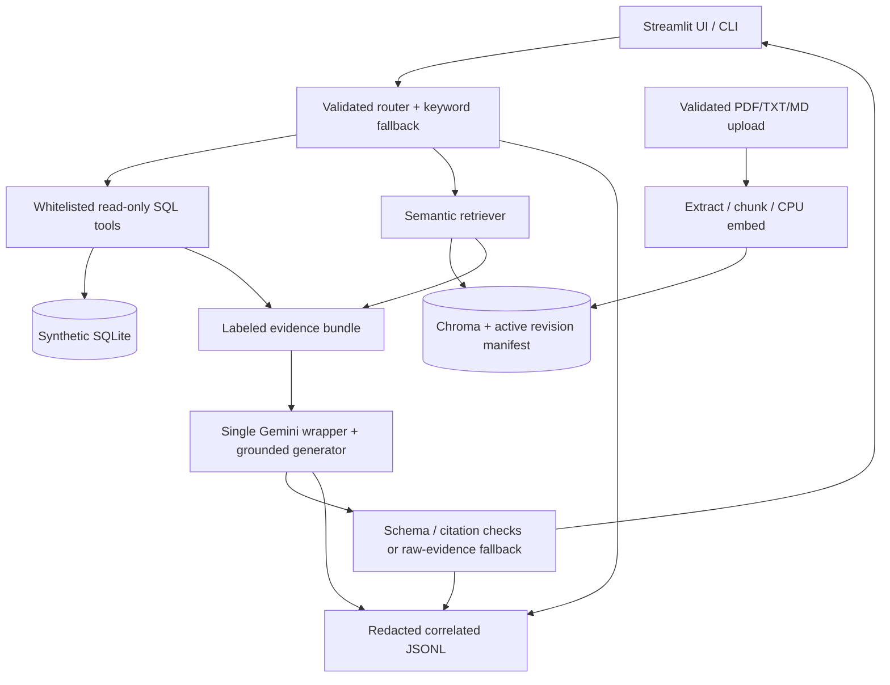

# Ten-slide outline

1. **Problem** — University facts live in records and policy documents; generic
   chat can give unsupported answers. All demo data is synthetic.
2. **Solution** — One question, selected synthetic student, four routes, visible
   evidence, and explicit missing/conflicting-information behavior.
3. **Architecture** — Show the diagram below and explain the separate read/write
   paths, model boundary, active document revisions, and runtime volumes.
4. **Routing** — Validated JSON plus fixed tool registry, deterministic fallback,
   student identity bound outside the model, OUT_OF_SCOPE without answer generation.
5. **RAG pipeline** — PDF/TXT extraction, page-bound chunks, normalized CPU MiniLM
   vectors, persistent cosine search, thresholding, file/page provenance.
6. **SQL safety** — Read-only URI, bound parameters, identifier validation, predefined
   tools, synthetic selector; production authentication/authorization is future work.
7. **Demo** — GPA/fees, attendance, hybrid criteria/deadline conflict, overdue variant.
8. **Evaluation** — Copy only actual current figures from `../EVALUATION_RESULTS.md`
   and CSV artifacts. Show sample counts/mode, held-out split, fallbacks, latency,
   and human-review status. Do not present structural tags as faithfulness.
9. **Risks** — Provider load/quota, coarse fallback routing, retrieval false negatives,
   imperfect injection mitigation, synthetic-only evaluation, and no authentication.
10. **Future work** — Auth/row-level access, better retrieval/reranking, explicit
    policy authority rules, conversation-aware retrieval, and broader evaluation.

SQLite, vectors, model cache, and logs persist in volumes; keys are supplied at
runtime. Docker images contain code/dependencies and synthetic source fixtures.
